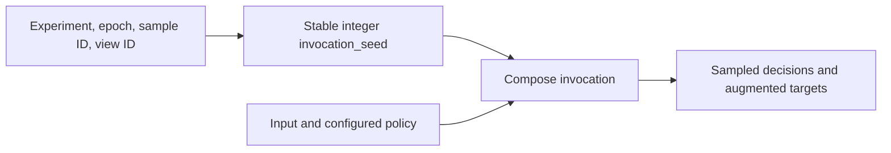

# Determinism and replay

Use a pipeline seed to repeat an experiment with the same execution setup. Use `invocation_seed` to repeat a
particular sample when worker assignment or call order changes. Save a replay record when you need the parameters
that were actually applied.

These guarantees assume the same configured graph, input values and target metadata, library revision, dependencies,
platform, and supported execution path. Custom transforms and callbacks must obey the same sampling contract.

## Repeat an ordered sequence

`Compose(seed=137)` owns its Python and NumPy random sources. Global `random.seed()` and `np.random.seed()` do not
control them. With the same graph, seed, inputs, and ordered calls on the same execution thread, two fresh pipelines
produce the same sampled decisions and outputs. Calling one pipeline repeatedly advances its stream.
`set_random_seed(137)` resets that stream. An unseeded pipeline has no reproducibility guarantee.

```python
import numpy as np
import albumentations as A


def make_pipeline():
    return A.Compose(
        [A.HorizontalFlip(p=0.5), A.RandomBrightnessContrast(p=0.7)],
        seed=137,
    )


image = np.arange(24 * 32 * 3, dtype=np.uint8).reshape(24, 32, 3)
first, second = make_pipeline(), make_pipeline()
initial = first(image=image)["image"]
np.testing.assert_array_equal(initial, second(image=image)["image"])
for _ in range(3):
    np.testing.assert_array_equal(first(image=image)["image"], second(image=image)["image"])
first.set_random_seed(137)
np.testing.assert_array_equal(first(image=image)["image"], initial)
```

Nested `Compose`, `ReplayCompose`, `OneOf`, `SomeOf`, `RandomOrder`, `OneOrOther`, `Sequential`, and
`SelectiveChannelTransform` share the enclosing invocation's random sources. A child seed does not create an
independent stream while that child runs inside a configured parent. A separate public `Compose(...)` call made by
custom code opens a separate root invocation.

## Repeat a sample independently of call order

`pipeline(..., invocation_seed=137)` creates isolated sources for that call. Reusing that seed with the same graph
and input repeats the sample, regardless of intervening calls. It does not advance or reset the configured stream.
The same option is available on `ReplayCompose` and `run_with_trace()`.

```python
import numpy as np
import albumentations as A

image = np.arange(24 * 32 * 3, dtype=np.uint8).reshape(24, 32, 3)
pipeline = A.Compose([A.RandomBrightnessContrast(p=1.0)], seed=137)
expected = pipeline(image=image, invocation_seed=137)["image"]
pipeline(image=image)
actual = pipeline(image=image, invocation_seed=137)["image"]
np.testing.assert_array_equal(actual, expected)
pipeline.set_random_seed(137)
pipeline(image=image, invocation_seed=137)
after_explicit_call = pipeline(image=image)["image"]
pipeline.set_random_seed(137)
np.testing.assert_array_equal(after_explicit_call, pipeline(image=image)["image"])
```

Choose the seed from stable sample identity. Include experiment seed, epoch, sample ID, and view ID when those should
produce different augmentation. Avoid Python's process-randomized `hash()`, arrival order, and worker ID. For example,
`int(np.random.SeedSequence([137, epoch, sample_id, view_id]).generate_state(1, dtype=np.uint64)[0])` gives a stable
integer key for non-negative integer fields. Persist the mapping along with the experiment configuration.



## PyTorch DataLoader workers

For ordinary calls, each worker combines the pipeline seed with its PyTorch worker seed and maintains a local
stream. Seed the loader's `generator` as well as `Compose`. Reproducibility requires the same worker count,
persistence setting, sampler order, batch assignment, and ordered calls. Global seeds alone do not establish this
contract. Do not reset every worker's pipeline to an identical manual RNG state.

Persistent workers keep advancing their streams between epochs. Respawned workers receive new worker seeds from
the loader generator. Recreating the same loader configuration with a freshly seeded generator reproduces its
sequence; merely starting another epoch does not restart augmentation.

Changing `num_workers` can change ordinary augmentations. This is the expectation reported in
[#81](https://github.com/albumentations-team/AlbumentationsX/issues/81). For worker-count-independent sample identity,
pass a stable `invocation_seed` in `Dataset.__getitem__`. Pass the epoch as part of each sample request: changing an
attribute on the parent dataset does not update copies already held by persistent worker processes.

Save this example as a Python file and run it. The guard and module-level dataset make it compatible with `spawn`.

```python
import numpy as np
import torch
from torch.utils.data import DataLoader, Dataset
import albumentations as A


class Images(Dataset):
    def __init__(self):
        self.pipeline = A.Compose([A.RandomBrightnessContrast(p=1.0)], seed=137)

    def __len__(self):
        return 8

    def __getitem__(self, request):
        epoch, sample_id = divmod(request, len(self))
        seed = int(np.random.SeedSequence([137, epoch, sample_id]).generate_state(1, dtype=np.uint64)[0])
        image = np.full((24, 32, 3), 137, dtype=np.uint8)
        return self.pipeline(image=image, invocation_seed=seed)["image"]


def collect(num_workers):
    dataset = Images()
    requests = list(range(len(dataset)))
    loader = DataLoader(
        dataset,
        sampler=requests,
        batch_size=4,
        num_workers=num_workers,
        persistent_workers=num_workers > 0,
        multiprocessing_context="spawn" if num_workers else None,
        generator=torch.Generator().manual_seed(137),
    )
    epochs = []
    for epoch in range(2):
        requests[:] = range(epoch * len(dataset), (epoch + 1) * len(dataset))
        epochs.append(torch.cat(list(loader)).numpy())
    return np.stack(epochs)


if __name__ == "__main__":
    np.testing.assert_array_equal(collect(0), collect(2))
```

This controls augmentation only. Dataset decoding, external random code, samplers, model operations, and distributed
training have their own reproducibility requirements.

## Concurrent calls

Concurrent calls on one configured pipeline keep execution state isolated. Each execution thread advances a private
stream; the configuring thread uses its original stream. Scheduling determines which other thread first reserves
each derived stream. Neither caller-to-stream assignment nor a worker-count-independent order is promised.
Use explicit sample keys when results must survive a different schedule. Do not reseed or mutate the configured
graph while calls are running.

```python
from concurrent.futures import ThreadPoolExecutor
import numpy as np
import albumentations as A

image = np.full((24, 32, 3), 137, dtype=np.uint8)
pipeline = A.Compose([A.RandomBrightnessContrast(p=1.0)], seed=137)


def augment(seed):
    return pipeline(image=image, invocation_seed=seed)["image"]


seeds = [137, 138, 139]
expected = [augment(seed) for seed in seeds]
with ThreadPoolExecutor(max_workers=2) as executor:
    actual = list(executor.map(augment, reversed(seeds)))
for first, second in zip(expected, reversed(actual), strict=True):
    np.testing.assert_array_equal(first, second)
```

## Failure and stream consumption

Root input validation runs before random probability or sampling draws. Rejected input containers, ranks, aligned
shapes, and root annotation formats therefore do not advance the configured stream. Creating an invocation does
not necessarily reserve or draw from its lazy RNG sources. A deterministic no-op need not consume randomness.

```python
import numpy as np
import albumentations as A

image = np.arange(24 * 32 * 3, dtype=np.uint8).reshape(24, 32, 3)
pipeline = A.Compose([A.RandomBrightnessContrast(p=1.0)], seed=137)
reference = A.Compose([A.RandomBrightnessContrast(p=1.0)], seed=137)
try:
    pipeline(image=np.zeros((3,), dtype=np.uint8))
except TypeError:
    pass
else:
    raise AssertionError("Invalid image rank was accepted")
np.testing.assert_array_equal(pipeline(image=image)["image"], reference(image=image)["image"])
```

An execution failure preserves every draw already consumed; there is no RNG rollback. This includes failures in a
custom sampler, target handler, callback, or later execution validation. Retrying an ordinary call therefore need
not repeat the failed sample. Retrying with the same explicit `invocation_seed` restarts that sample's isolated
random sources, provided the input and configuration are unchanged. Failed calls publish no partial applied
observation. See the [validation contract](validation.md) for rejection behavior.

## Choose the persistence contract

| Mechanism | What it saves | What it reproduces |
| --- | --- | --- |
| Constructor serialization: `A.to_dict` / `A.from_dict`, JSON, YAML | Configured stochastic graph and seed | A fresh configured sequence under the same execution setup; it does not save the current stream position |
| `ReplayCompose` | Parameters and applied/skipped decisions for one call | That invocation on compatible input targets, without resampling |
| Applied configuration: `save_applied_params=True` and `Compose.from_applied_transforms` | Realized constructor policy for applied transforms | A runnable reconstructed policy; exactness depends on the registered transform case |

```python
import json
import numpy as np
import albumentations as A

image = np.arange(24 * 32 * 3, dtype=np.uint8).reshape(24, 32, 3)
pipeline = A.Compose([A.HorizontalFlip(p=0.5)], seed=137)
restored = A.from_dict(json.loads(json.dumps(A.to_dict(pipeline))))
np.testing.assert_array_equal(pipeline(image=image)["image"], restored(image=image)["image"])

replay_pipeline = A.ReplayCompose([A.HorizontalFlip(p=0.5)], seed=137)
sample = replay_pipeline(image=image)
replayed = A.ReplayCompose.replay(sample["replay"], image=image)
np.testing.assert_array_equal(sample["image"], replayed["image"])

recorded = A.Compose([A.HorizontalFlip(p=1.0)], seed=137, save_applied_params=True)(image=image)
record = json.loads(json.dumps(recorded["applied_transforms"]))
applied = A.Compose.from_applied_transforms(record)
np.testing.assert_array_equal(recorded["image"], applied(image=image)["image"])
```

Pickle is a Python process transport, used by spawned workers, rather than a portable experiment format.
Process-local locks and thread reservations are rebuilt on unpickling; automatic sources synchronize with the
receiving DataLoader worker seed. Persist sample keys or replay records for durable sample identity.

## Version and exactness boundary

A seed is not a promise of identical random sequences across releases, changed graphs, dependency versions,
platforms, dtypes, or backend routes. Pin the environment and preserve input data when comparing exact outputs.
Interpolation and numerical kernels can change pixels even when sampled parameters agree.

Cross-version exact output stability applies only to cases registered with an exact stability contract, within
that contract's declared environment. Replay and applied-configuration cases declare their own strength; see the
[applied-configuration contracts](design/applied-config-replay-contracts.md) and
[correctness contracts](maintaining/correctness-contracts.md). No general cross-platform bitwise guarantee is made.

The [composition audit and CI evidence](maintaining/determinism-audit.md) map these guarantees to permanent tests.
