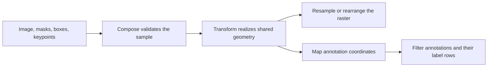

# 2D geometry contract

Pass an image and its masks, boxes, and keypoints to one `Compose` call so they use the same realized geometry. This
page defines how to interpret the coordinates, when an annotation can disappear, and which results the tests compare.
Use the [transform target declarations](../README.md#list-of-augmentations) to check which targets a transform accepts.

## Coordinate systems

`(H, W)` describes the frame as height and width. A raster is indexed as `[y, x]`, while geometric coordinates are
written `(x, y)`. The origin is at the upper left, `x` increases to the right, and `y` increases down. Public NumPy and
CPU Tensor layouts differ. Both use the same spatial conventions. [Target layouts](design/numpy-tensor-routing.md)

| Target | Coordinate convention |
| --- | --- |
| Image and mask | Raster row `y` and column `x` address the pixel with center `(x, y)`. The first and last column centers are `0` and `W - 1`. In pixel-center coordinates the frame extends from `-0.5` to `W - 0.5` horizontally and from `-0.5` to `H - 0.5` vertically. |
| Keypoint | Spatial fields are absolute pixel-center coordinates and may be fractional. `coord_format` sets the order and presence of coordinate, angle, and scale fields. `angle_in_degrees` controls the public angle units. The default is degrees. |
| Horizontal bounding box (HBB) | Absolute edge coordinates range from `0` to `W` horizontally and `0` to `H` vertically. A box `[x_min, y_min, x_max, y_max]` has width `x_max - x_min` and height `y_max - y_min`. A full-frame box has maximum edges `(W, H)`. Normalization divides x coordinates by `W` and y coordinates by `H`. |
| Oriented bounding box (OBB) | The center, side lengths, and angle describe a rotated rectangle. In the internal box format the first four fields encode center ± half side lengths before rotation. The fifth field is the width-edge angle in degrees, measured from positive x toward positive y. Convert normalized coordinates back to pixels before reconstructing the corners of a box on a non-square frame. A box fitted from corners chooses the more horizontal edge as its width and represents the angle in `[-90, 90)`. A transform that preserves the rectangle can retain its original angle representation. |

Set `BboxParams.coord_format` for the incoming box format and `bbox_type="obb"` for oriented boxes. Extra columns can
carry metadata and do not select the box type. A transform called directly with boxes expects normalized HBB
coordinates. Use `Compose` with `BboxParams` for other formats or oriented boxes. The crop window
`(x_min, y_min, x_max, y_max)` uses half-open intervals
and selects `image[y_min:y_max, x_min:x_max]`. [Box formats](design/bounding_boxes.md) ·
[Coordinate tests](../tests/test_keypoint.py) · [Box tests](../tests/test_bbox.py)

For example, a horizontal flip of a frame with width `7` sends a keypoint at `x = 0` to `x = 6`. A box covering that
first pixel has edges `[0, 1]` along x and moves to `[6, 7]`. The keypoint rule is `W - 1 - x`, and the edge rule is
`W - x`. These are the same reflection expressed in the two coordinate systems.

## Geometry is shared across targets

Images, masks, and spatial aliases in the same sample use an aligned frame when they consume shared geometry. The
transform samples its policy once in `sample_parameters`. The realized values describe the window, offsets, matrix,
grid, or permutation that the raster and annotation handlers use. A transform may express the same operation in the
pixel-center and box-edge systems. The `TargetParams` contract carries parameters that depend on a target's
representation. [Parameter contract](design/target-specific-parameter-sampling.md)

`ReplayCompose` uses the saved parameters. Rebuilding derived matrices or maps from a saved mesh or control grid is
deterministic. Replay is tested on the recorded spatial frame. A saved scale from `RandomScale`, `LongestMaxSize`, or
`SmallestMaxSize` can also be applied to another aligned frame. Those transforms compute the output shape and the
annotation mapping from the new dimensions. `Resize` retains its recorded output size. `LetterBox` retains the recorded
intermediate resize dimensions and all four padding amounts. Both map annotations from the current input frame into
that recorded output geometry. Spatially materialized parameters may require the recorded shape. See
[replay contracts](design/applied-config-replay-contracts.md) and the [resize replay tests](../tests/contracts/test_geometry_contract.py).

## Bounds, filtering, and annotation rows

`Compose` checks input kinds, ranks, annotation rows, finite coordinates, label counts, and spatial alignment before
the probability draw where those checks are knowable. Valid empty annotations are accepted. Setting
`is_check_shapes=False` skips the root alignment check. A sampler that needs a common frame can still require aligned
targets. A valid skipped call returns the original targets. [Validation contract](validation.md) ·
[Validation tests](../tests/contracts/test_validation_contract.py)

| Stage | Boxes | Keypoints |
| --- | --- | --- |
| Input preparation | Convert to normalized coordinates. `clip_bboxes_on_input=True` clamps the first four normalized fields before the pipeline. `filter_invalid_bboxes=True` removes invalid rows during preparation. With the default bounds check, surviving input boxes need positive width and height and coordinates in `[0, 1]`, subject to the check's floating-point tolerance. | `remove_invisible=True` checks positions against the closed intervals `[-0.5, W - 0.5]` and `[-0.5, H - 0.5]`. With `remove_invisible=False`, the processor accepts finite points outside the frame. Individual transforms can still clip or remove points as part of their mapping. |
| After a transform | With `clip_after_transform=True`, clamp HBB edges to the output frame. The processor's OBB clipping path can replace a boundary-crossing rectangle with an axis-aligned enclosure. The processor applies `min_area`, `min_visibility`, `min_width`, `min_height`, and `max_accept_ratio` to the resulting boxes. Area and size thresholds are in output pixels. Visibility compares retained area with the area before processor clipping. | With `remove_invisible=True`, the processor removes points outside the output frame. Some remap algorithms can lose a point when its marker has no output pixel. |
| Timing and return | With `check_each_transform=True`, filter after operations that can affect the boxes. Final processing applies any outstanding filter and returns the requested coordinate format. `clip_after_transform=False` allows out-of-frame coordinates while the size and area filters still apply. | With `check_each_transform=True`, filter after operations that can affect the points. Final processing filters as needed and returns the requested coordinate format. |

A box with zero area fails default input validation or is removed by the applicable filtering path. An annotation
with `NaN` or `Inf` in a coordinate field fails input validation. A crop or warp can remove all annotations. With no
extra columns, the empty array results have shape `(0, 4)` for HBB, `(0, 5)` for OBB, and `(0, 2)` for `xy`
keypoints. Label fields follow the rows that survive, including the empty result. An instance-bound pipeline also
keeps the bound targets aligned with the surviving instances. [Box processing](design/bounding_boxes.md) ·
[Instance binding](design/instance_binding.md) · [Complete removal tests](../tests/contracts/test_geometry_contract.py)

The output frame and the annotations have separate validity rules. When a `CropAndPad` request would empty an axis,
the transform reduces the crop amounts to retain one pixel on that axis before padding or resizing. The configured
annotation filters determine which rows survive. The boundary tests distinguish points exactly on the crop edge from
points just outside it. [Extreme geometry tests](../tests/contracts/test_geometry_contract.py) ·
[Subpixel boundary properties](../tests/property/test_bounds_shape_dtype.py)

## Interpolation, borders, and fill

Operations that only slice, pad, permute, or flip pixels do not resample the original pixels. Resize, affine,
perspective, and most elastic or remap transforms default to linear interpolation for images and nearest neighbor
for masks. PixelSpread defaults to nearest neighbor for both. A pure crop or pad ignores interpolation because it
performs no resize. A combined crop and resize uses interpolation at its resize stage.

The common interpolation flags are `INTER_NEAREST`, `INTER_LINEAR`, `INTER_CUBIC`, `INTER_AREA`, and
`INTER_LANCZOS4`. Resize constructors that expose `FullInterpolationType` also accept `INTER_LINEAR_EXACT` and
`INTER_NEAREST_EXACT`. Use the flags accepted by the selected transform. `Compose(mask_interpolation=...)` replaces
the mask setting recursively on transforms that expose it. Where `area_for_downscale` is supported, `"image"` can
select area interpolation for a shrinking image and `"image_mask"` can also select it for a shrinking mask. The
area policy takes precedence in those cases. `RandomScale` and the max-size transforms use the sampled scale to
decide whether to switch. Fixed resize and the sized crops that expose this option compare input and output sizes.
[Interpolation types](../albumentations/core/type_definitions.py) ·
[Downscale tests](../tests/test_resize_area_downscale.py)

Nearest neighbor on a categorical mask samples existing IDs, plus the representable fill value where constant
padding is used. A mixing interpolation can introduce new values. Image and mask resampling preserve their supported
input dtype. The usual image ranges are `[0, 255]` for `uint8` and `[0, 1]` for normalized floating images. Paths that
can overshoot during cubic or Lanczos interpolation clip new floating image samples to `[0, 1]`. Masks use their own
interpolation and dtype semantics. [Mask interpolation tests](../tests/test_transforms.py) ·
[Image range tests](../tests/contracts/test_image_range_contract.py)

Where `border_mode` is configurable, `BORDER_CONSTANT` uses `fill` for images and `fill_mask` for masks. The common
default is constant zero. `BORDER_REPLICATE` extends the edge, `BORDER_WRAP` repeats the raster periodically, and
`BORDER_REFLECT` and `BORDER_REFLECT_101` mirror it with different treatment of the edge sample. PixelSpread and
WaterRefraction default to `BORDER_REFLECT_101`. LetterBox and GridElasticDeform use fixed constant padding or fill.
Padding and affine paths that explicitly support reflected annotations can create reflected copies. Other annotation
paths follow the family's coordinate or mask policy, so a raster border mode alone gives no guarantee of copied
annotations. [Pad and reflection tests](../tests/test_bbox.py) · [Fill tests](../tests/test_crop.py)

## Rules and tests by family

The [transform case registry](../tests/helpers/transform_cases.py) is the source of constructor modes. The audit starts
with its `DualTransform` cases from the crop and geometric modules, then follows aliases and checks the remaining
2D dual transforms for their annotation semantics. The [generated target suite](../tests/contracts/test_target_cluster_contract.py)
applies each case to the profiles supported by its declared targets and bbox types. It checks shape, dtype, metadata,
caller input ownership, and replay. The focused tests below add geometric oracles for specific behaviors.

| Family | Realized geometry and target rules | Focused tests |
| --- | --- | --- |
| Flips, transpose, quarter turns, and square symmetries | Apply an index permutation or one sampled group element. Images and masks use the same permutation. Keypoints use pixel centers, and HBB and OBB geometry follows the corresponding edge mapping. Transpose and odd quarter turns exchange height and width. Use a square frame for square symmetries. `TimeReverse` follows the horizontal flip rule. | [Symmetry invariants and OBB corners](../tests/test_symmetry_contracts.py), [regression vectors](../tests/regression/test_golden_vectors.py), [keypoint boundaries](../tests/test_keypoint.py). |
| Crop and crop with resize | Share one integer crop window. Translate points and boxes by its origin and normalize boxes in the cropped frame. Center crop uses floor division of the excess size, so an odd excess leaves the larger remainder on the bottom or right. When the transform supports pad-before-crop, apply the sampled padding before the slice. A sized crop resizes the window to its configured output size. `CropAndPad` uses signed side amounts and can resize the intermediate frame back to the input size with `keep_size=True`. It truncates percentage amounts to integer pixels. When the intermediate and output dimensions give different scales on the two axes, the resize stage refits OBBs from their scaled corners. | [Crop windows and safe sampling](../tests/test_crop.py), [crop/pad OBB and labels](../tests/test_crops_obb.py), [resized crop](../tests/test_random_resized_crop.py), [non-uniform OBB resize](../tests/contracts/test_geometry_contract.py). |
| Resize and letterboxing | Compute the output shape before resampling. `Resize` uses the requested shape. `RandomScale` truncates the scaled dimensions with `int`. `LongestMaxSize`, `SmallestMaxSize`, and `LetterBox` round scaled dimensions with `round`. These sampled resize paths enforce at least one pixel per axis. Use effective scales `W_out / W_in` and `H_out / H_in` after rounding. A keypoint maps as `(x + 0.5) * scale_x - 0.5`, with the analogous y rule. Normalized HBB extents stay invariant under pure resize. OBBs are fitted from transformed corners when the scales differ. `LetterBox` adds its integer padding after resizing. | [Effective scales and cross-size replay](../tests/contracts/test_geometry_contract.py), [keypoint alignment](../tests/test_keypoint.py), [resize OBB](../tests/test_resize_obb.py), [interpolation selection](../tests/test_resize_area_downscale.py). |
| Padding | Share integer top, bottom, left, and right offsets. The output size adds the offsets to the input dimensions. `PadIfNeeded` chooses padding to satisfy the configured minimum size or divisor. Center placement puts an odd remainder on the bottom or right. With ordinary padding, translate points and boxes by `(left, top)`. Reflect modes use the reflected-annotation path where supported. | [Padding size and fill](../tests/test_transforms.py), [reflected boxes](../tests/test_bbox.py), [oriented boxes and extra fields](../tests/test_crops_obb.py). |
| Rotation and affine | Sample one policy. Raster and keypoint matrices use center `((W - 1) / 2, (H - 1) / 2)`. Box matrices use `(W / 2, H / 2)`. Affine applies scale, rotation, shear, and translation relative to the pivot. `fit_output` floors the transformed minima, ceils the maxima, translates the origin, and sets each dimension to `maximum - minimum + 1`. `Rotate(crop_border=True)` applies a sampled interior crop after the warp. `SafeRotate` scales the rotated frame into the input size. HBBs follow the selected box-enclosure method. OBBs use transformed corners on the affine path. | [Affine matrix, pivots, and geometry](../tests/functional/test_affine.py), [rotated crop and safe rotation](../tests/test_transforms.py), [analytical OBB tests](../tests/test_obb_analytical.py). |
| Perspective | Sample one quadrilateral and homography. The base width and height use the longer corresponding sides of the sampled quadrilateral, with a minimum side length of two during estimation and truncation to integers. `fit_output` expands the frame and rounds the translated corners. `keep_size=True` composes the output scale into the homography once. Rasters, keypoint positions, and box corners share the final matrix. HBBs enclose mapped corners. OBBs are constructed and fitted in pixel coordinates, then normalized in the output frame. Replay uses the recorded homography and perspective frame dimensions. With `keep_size=True` the output scale targets the current input dimensions. | [Single warp and aligned keypoints](../tests/test_transforms.py), [projection and angle handling](../tests/test_keypoint.py), [rectangular-frame OBBs, matrix sharing, and legacy replay](../tests/contracts/test_geometry_contract.py). |
| Remap distortions | Share a pair of output-to-input coordinate maps. Distortion modes that sample a lower map resolution expand the maps to the output frame before use. Boxes use rasterized support, nearest-neighbor remap, and recovery of enclosing boxes. For OBBs the support polygon comes from the rotated corners rounded to pixels. An exact identity map preserves the OBB through the remap step without mask quantization. The mask keypoint method rasterizes point markers and returns output pixel locations. The direct method uses a discrete inverse map. ElasticTransform uses its continuous control-field inverse for keypoints and shares dense maps for raster targets and boxes. | [Map resolution and target alignment](../tests/test_distortion_map_resolution.py), [remap algorithms](../tests/functional/test_geometric.py), [elastic inverse and replay](../tests/test_elastic_transform.py), [OBB identity and warped support](../tests/contracts/test_geometry_contract.py). |
| Grid elastic deformation | Sample source rectangles and destination quadrilaterals. Prepare one homography per cell and share it across raster targets, HBB masks, and keypoints. Later destination cells overwrite earlier cells at overlap. Keypoints use half-open source cells, followed by clipping to pixel centers. HBBs enclose warped binary support. A saved `generated_mesh` is sufficient for replay. | [Shared matrices, cell boundaries, legacy replay, and wide masks](../tests/contracts/test_geometry_contract.py). |
| Grid shuffle | Sample integer tiles and a permutation within groups of equal tile shape. Image and mask tiles move without resampling. Keypoints move by the offset of their source tile. Boxes are rebuilt from visible components of the permuted box masks, so a box crossing tiles can yield multiple surviving boxes. | [Tile construction](../tests/functional/test_geometric.py), [image permutation](../tests/test_transforms.py), [keypoint tile offsets](../tests/test_keypoint.py), [box components, visibility, and metadata](../tests/test_bbox.py). |
| Morphology | Use one elliptical structuring element for erosion or dilation in the existing frame. HBBs follow the bounds of their independently processed binary masks. Keypoint positions stay in the same frame. | [Morphology and dtype](../tests/functional/test_morphology.py), [box morphology](../tests/test_bbox.py). |

If a remap leaves a box's binary mask empty, the remap stage retains the original box coordinates and metadata.
The configured box processor still applies its output filters. [Empty support tests](../tests/test_bbox.py)

The same registry includes 2D dual cases whose annotation semantics follow a different rule.

| Family | Geometry and annotation rule | Tests |
| --- | --- | --- |
| Occlusion and spectrogram masking | Keep the frame. Apply sampled holes or bands to supported rasters. Where supported, annotation handling follows visibility under the occlusion and the configured filters. | [Occluded box and point support](../tests/functional/test_dropout.py), [declared target profiles](../tests/contracts/test_target_cluster_contract.py). |
| Mixing and overlays | Place each source in the destination frame. Mosaic uses per-source resize and crop. CopyAndPaste places donor objects and applies visibility rules. OverlayElements places metadata-defined patches on supported rasters. | [Mosaic geometry](design/mosaic.md), [paired donor targets](../tests/test_mosaic_additional_targets.py), [CopyAndPaste instance binding](../tests/test_instance_binding.py), [declared target profiles](../tests/contracts/test_target_cluster_contract.py). |
| Identity | `NoOp` leaves the frame and coordinates in place. `Compose` still uses the configured annotation processors. | [Identity properties](../tests/property/test_composition_consistency.py), [box processing with NoOp](../tests/test_bbox.py). |

## What the tests compare

- **Exact.** Use exact outputs for integer slicing and permutation and for selected deterministic regressions. The
  existing golden vectors cover flips, transpose, and quarter turns.
  [Regression manifest](../tests/files/regression/manifest.json)
- **With tolerance.** Compare coordinates and geometric invariants with a test-specific tolerance. Geometry tests
  calculate expected resize and perspective corners independently, then compare the fitted OBB.
  [Geometry regressions](../tests/contracts/test_geometry_contract.py) ·
  [Minimum-area rectangle tests](../tests/test_minarearect.py)
- **Structural.** For dependency-sensitive interpolation, check output shape, dtype, value bounds, mask IDs, and
  alignment. Extended profiles check empty HBB, OBB, and keypoint inputs with their label fields. Keep exact
  same-environment replay checks where the case declares them. [Stability modes](maintaining/correctness-contracts.md) ·
  [Target profile assertions](../tests/helpers/target_profiles.py)
