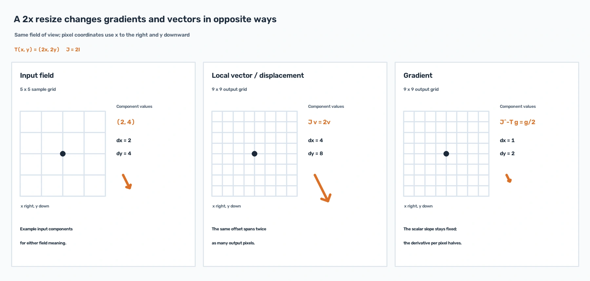
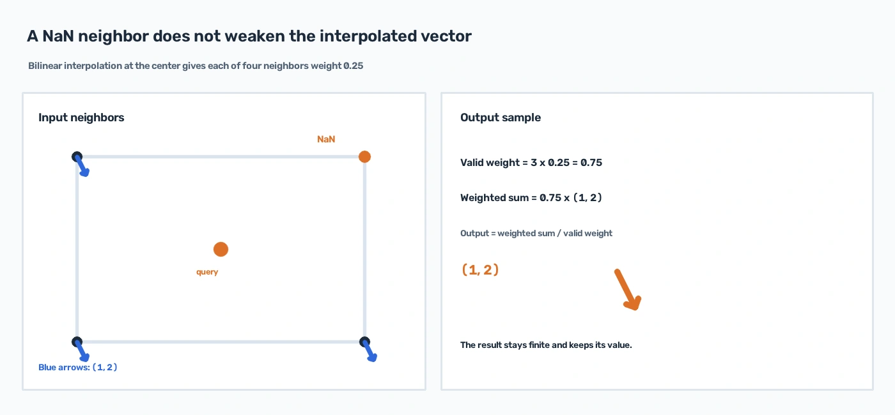
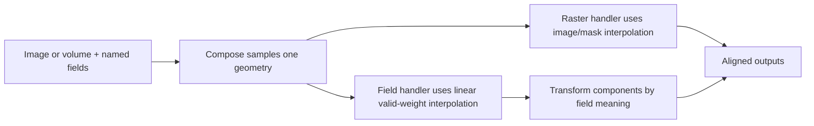

# Vector fields

Pass a gradient, displacement, local vector field, or surface normal to the same `Compose` call as its image or volume.
Spatial transforms then move the field onto the output grid and transform its components according to its meaning. This
keeps model inputs and dense predictions aligned after augmentation.

## Choose the target by meaning

The four meanings use different geometry rules:

| Target | Meaning | Component rule |
|---|---|---|
| `gradient`, `gradient3d` | Derivative of a scalar field, such as terrain height | Transform as a covector: `J^-T g` |
| `displacement`, `displacement3d` | Finite offset from a point to a second point | Transform both endpoints: `T(p + d) - T(p)` |
| `vector_field`, `vector_field3d` | Local vector, such as velocity or orientation | Transform with the local Jacobian: `J v` |
| `normal`, `normal3d` | Surface normal | Inverse transpose, then unit-normalize |

`normal` is stored on a 2D image grid with three components. The 2D deformation is lifted as
`F(x, y, z) = (T_x(x, y), T_y(x, y), z)`, so Z remains unchanged before the normal is normalized. Components use a
common frame: X points right, Y points down, and Z points along the image-depth axis. Convert tangent-space normals to
that frame before augmentation; no local tangent basis is stored. `normal3d` uses the full volume axes.

## Layouts and dtypes

Every field has a required component axis. NumPy uses channel-last layout; plain CPU Tensors use channel-first layout.
Only float16 and float32 are accepted.

| Targets | NumPy | CPU Tensor |
|---|---|---|
| `gradient`, `displacement`, `vector_field` | `(H, W, 2)` | `(2, H, W)` |
| `normal` | `(H, W, 3)` | `(3, H, W)` |
| `gradient3d`, `displacement3d`, `vector_field3d`, `normal3d` | `(D, H, W, 3)` | `(3, D, H, W)` |

Fields do not use image range scaling or clipping. Values may be negative or greater than one. Pass separately named
fields with `additional_targets`; there are no batched or collection field targets.
`ToTensorV2` and `ToTensor3D` move field components to the Tensor channel axis and preserve field dtype.

An alias uses the existing single-field handler. Pass both its canonical target and the alias:

```python
import albumentations as A
import numpy as np

image = np.zeros((16, 24, 1), dtype=np.float32)
gradient = np.ones((16, 24, 2), dtype=np.float32)
transform = A.Compose(
    [A.HorizontalFlip(p=1.0)],
    additional_targets={"gradient_aux": "gradient"},
    seed=137,
)
result = transform(image=image, gradient=gradient, gradient_aux=gradient.copy())
```

## Resize examples

A 2× resize changes a gradient from `(2, 4)` to `(1, 2)`. A local vector or displacement `(2, 4)` becomes `(4, 8)`.
For a 2D normal, Z is not scaled, so the normal direction changes when the image is resized.

```python
import albumentations as A
import numpy as np

image = np.zeros((64, 96, 1), dtype=np.float32)
gradient = np.empty((64, 96, 2), dtype=np.float32)
gradient[...] = (2.0, 4.0)

result = A.Compose([A.Resize(height=128, width=192)], seed=137)(image=image, gradient=gradient)
# result["gradient"].shape is (128, 192, 2); an interior vector is (1, 2).
```

The equivalent 3D resize scales all three spatial axes:

```python
import albumentations as A
import numpy as np

volume = np.zeros((8, 12, 16, 1), dtype=np.float16)
gradient3d = np.ones((8, 12, 16, 3), dtype=np.float16)

result = A.Compose([A.Resize3D(size=(16, 24, 32))], seed=137)(volume=volume, gradient3d=gradient3d)
# result["gradient3d"].shape is (16, 24, 32, 3); interior components are (0.5, 0.5, 0.5).
```



The same geometry parameters are sampled once and used by the image or volume route and every declared field route.
For interpolation-based transforms, fields always use bilinear sampling in 2D and trilinear sampling in 3D, independent
of the image and mask interpolation settings. Exact flips, crops, and axis permutations copy field values without
interpolation.

## Invalid vectors and boundaries

NaN marks invalid data without a separate mask target. If any component of an input vector is non-finite, the vector is
excluded from interpolation. The remaining valid neighbors use renormalized weights, so one NaN neighbor does not
weaken a constant field. If no valid neighbor contributes, the result is NaN in every component. Zero gradients and
zero displacements are valid; a zero normal is invalid.



Output points outside the input pixel or voxel cells are NaN regardless of the image border mode or fill value. Padding
therefore adds NaN field values. A known displacement endpoint can remain finite outside the visible output when the
transform can still compute its mapped location.

## Numerical limits and cost

Component calculations use float32 and are cast back to the input dtype. If a result overflows that dtype, the complete
vector becomes NaN. Use float32 when field magnitudes or transform scales may approach float16's finite range.

Nonlinear displacement transforms may iteratively invert their spatial map. The work grows with field size, so high-
resolution 3D fields can take substantially longer than affine transforms or local-vector fields.

Dropout transforms preserve fields unchanged, as they preserve masks. `CopyAndPaste`, `Mosaic`, `OverlayElements`,
`Morphological`, and `PixelSpread` skip their entire node when a field is present; they continue to run normally when
fields are absent. Check a transform's `Targets:` section for its declared field support.


